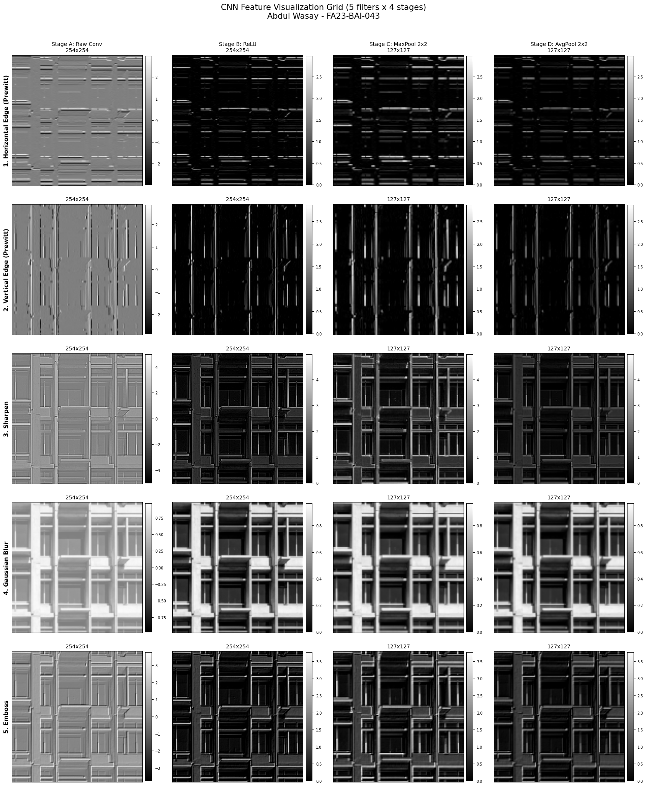

# CNN Feature Visualization & Parameter Audit

**Abdul Wasay** | FA23-BAI-043 | Computer Vision Lab

## Results
| Model | Manual | Keras |
|---|---|---|
| A (3×3, MaxPool) | 710 | 710 |
| B (5×5, AvgPool) | 1,750 | 1,750 |

Parameter increase A → B = 146.48%

## Part III: Answers

**Q1. ReLU blackout**
Dark lines under slabs and sills (row 1) and on the right edge of frames (row 2) were negative (bright→dark, min −2.76 / −2.85), so ReLU made them 0. Flat areas were already 0. Leaky ReLU (0.1) shows them faintly (−2.76 → −0.28). Sigmoid makes flat areas 0.5 and nothing is ever 0.

**Q2. Max vs Average pooling**
Max pooling kept the thin bright lines: Sharpen peak 4.98 (max) vs 3.26 (avg). Average pooling dilutes them. For dark ink on white, average pooling is better, because max would pick the white background and erase the strokes.

**Q3. Parameter growth and receptive field**
Increase = (1750 − 710) / 710 = **146.48%**. Two 3×3 layers give a 5×5 receptive field. With 10 channels: 2510 − 1820 = **690 saved** (27.5%).

**Q4. Operation order**
**Identical** (ReLU is monotonic). Patch [[4, −6], [−2, −8]]: ReLU→Max = 4, Max→ReLU = 4. Pooling first means 4× fewer ReLU operations. With average pooling the order changes the result (1 vs 0).

**Q5. Filter redundancy**
1. Unnormalized inputs (0–255) → every filter learns brightness. Fix: normalize and use He initialization.
2. Learning rate too low → filters barely move. Fix: Adam at 1e-3 plus BatchNorm.
